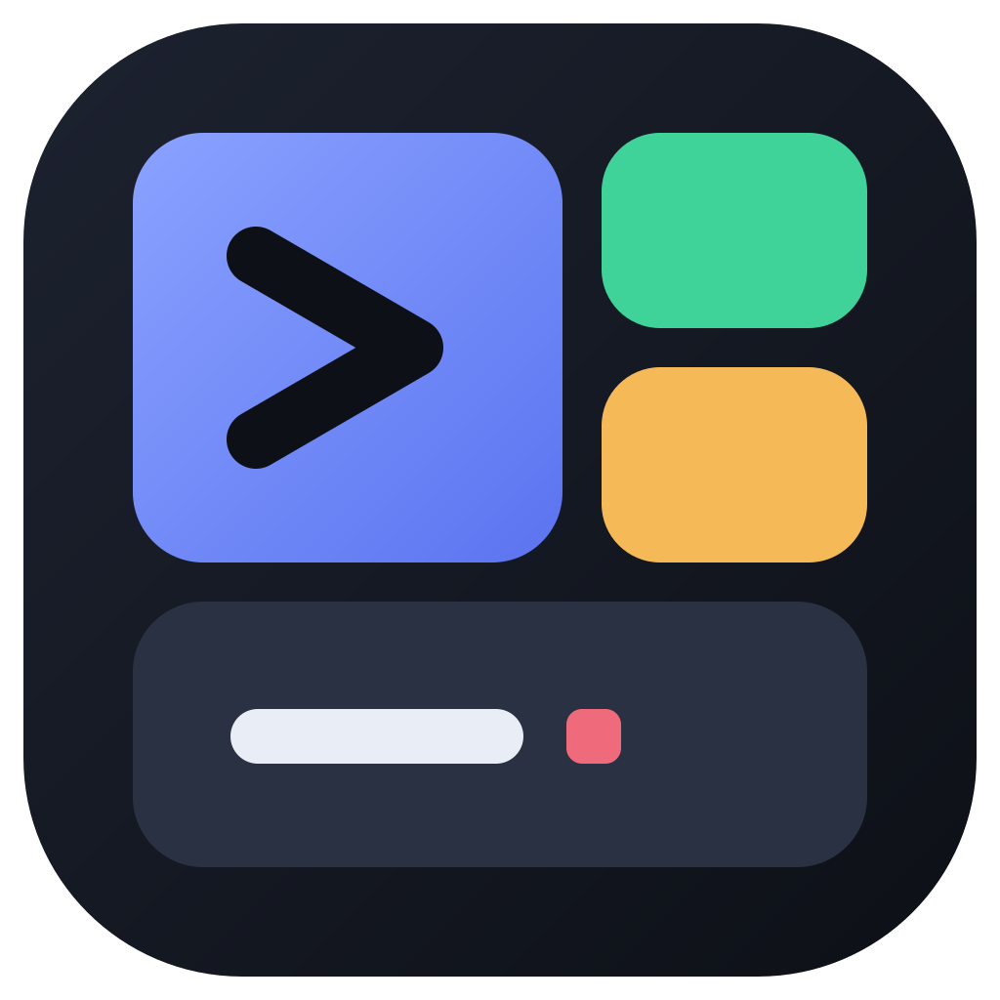
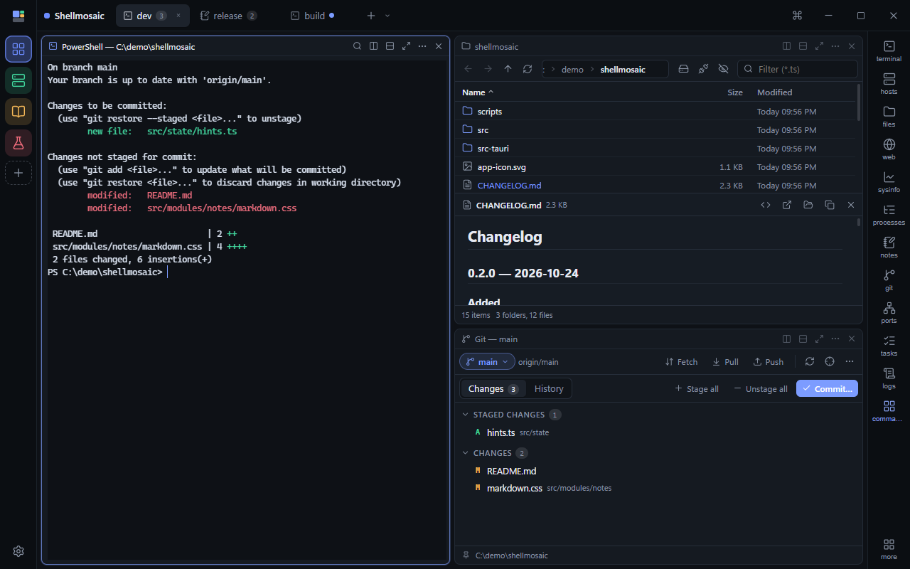
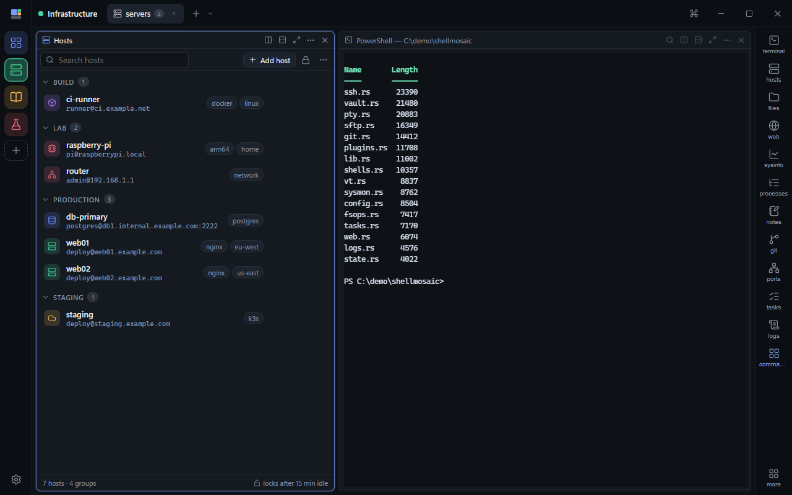
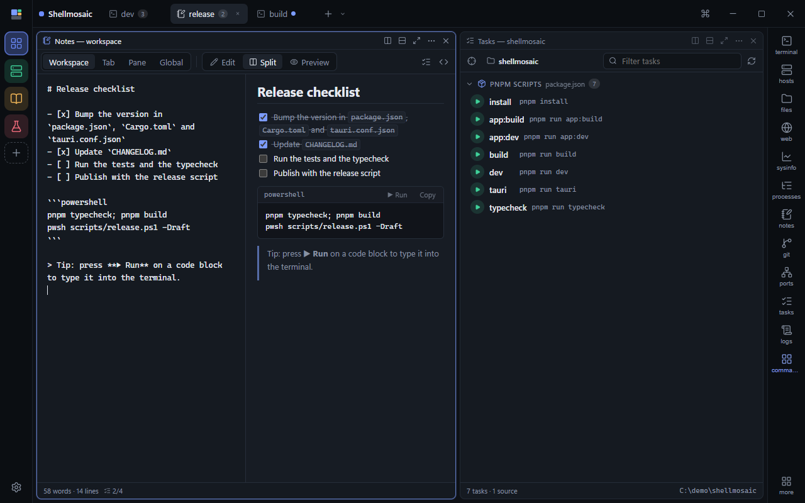
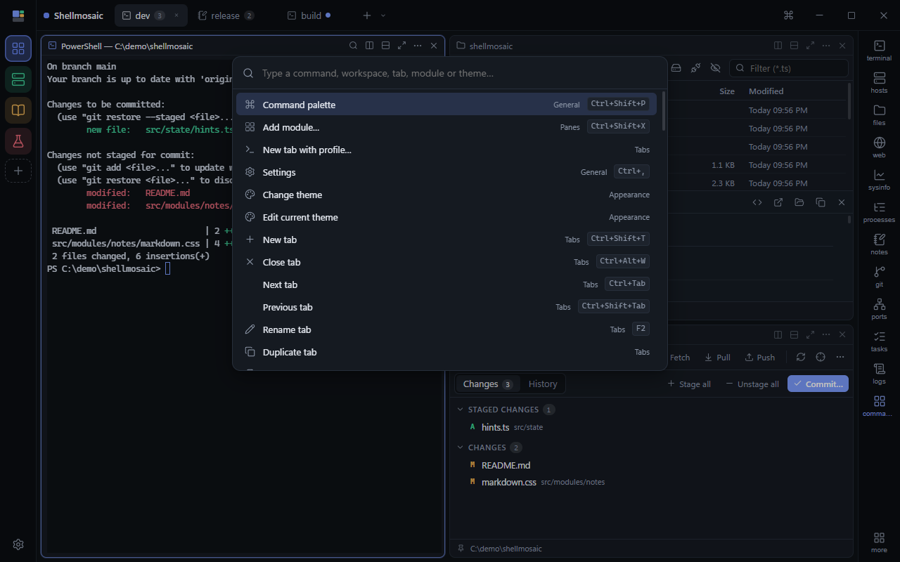
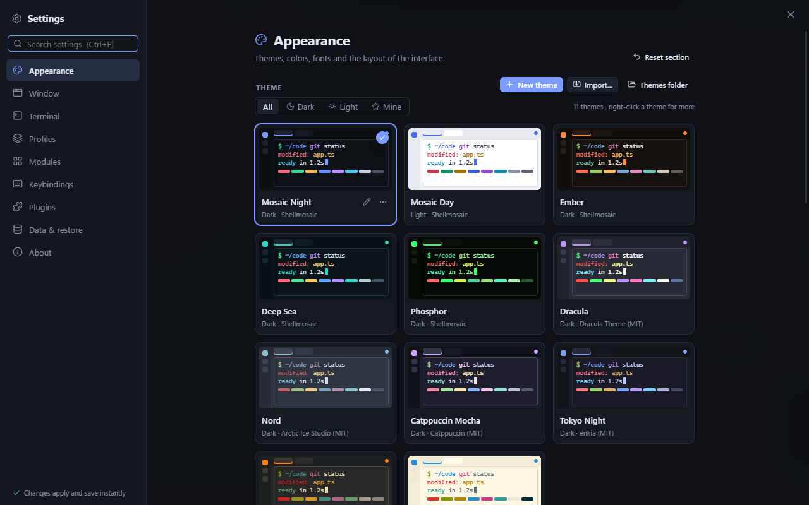
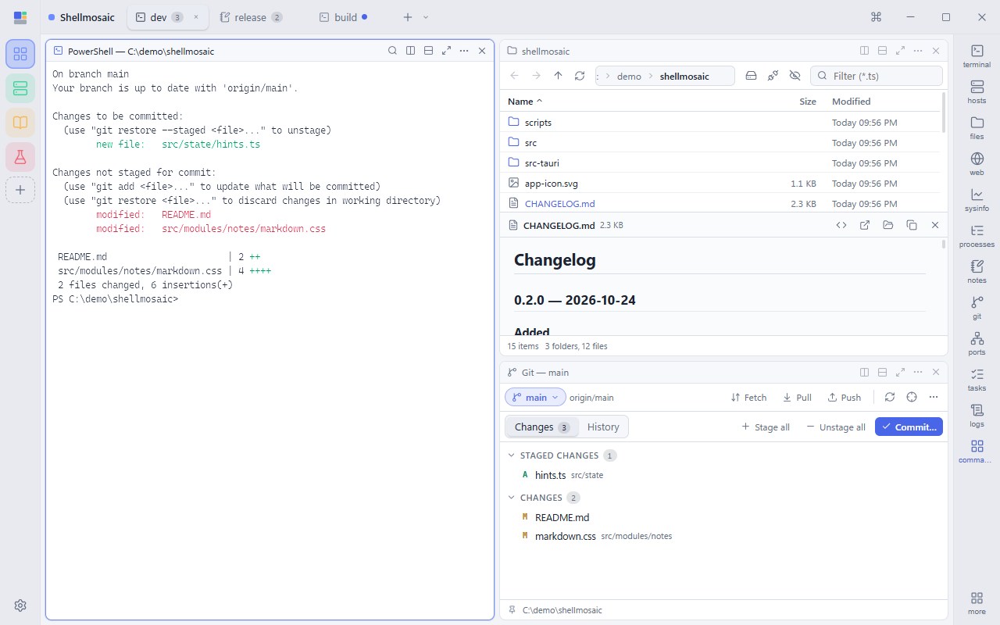

<div align="center">



# Shellmosaic

**A modular, workspace-based terminal for Windows.**

Tiling panes, workspaces and tabs, with the tools you keep switching to built in:
files, git, processes, ports, logs, notes, saved SSH hosts and SFTP.

<p>
  <a href="https://github.com/VinZie/shellmosaic/actions/workflows/ci.yml"></a>
  <a href="https://github.com/VinZie/shellmosaic/releases/latest"></a>
  <a href="LICENSE"></a>
  
  
</p>

<p>
  <a href="https://github.com/VinZie/shellmosaic/releases/latest"><b>Download</b></a> ·
  <a href="#screenshots">Screenshots</a> ·
  <a href="#quick-start">Quick start</a> ·
  <a href="#modules">Modules</a> ·
  <a href="#security-and-privacy">Security</a> ·
  <a href="#faq">FAQ</a> ·
  <a href="PLUGINS.md">Plugins</a> ·
  <a href="CONTRIBUTING.md">Contributing</a>
</p>



</div>

> [!NOTE]
> Shellmosaic 0.2 is an early release for Windows 10 and 11 (64-bit). The installer is not
> code-signed yet, so SmartScreen may warn the first time you run it.

Shellmosaic puts real ConPTY shells (PowerShell, cmd, Git Bash, WSL, your own profiles) and
remote SSH shells into tiling panes, groups them into tabs and workspaces, and sets the tools
you'd otherwise open in other windows right next to them. Everything you open comes back after
a restart, scrollback included.

## Why Shellmosaic

- **Workspaces, not just tabs.** A left rail of workspaces, each with its own tabs, color and
  icon. Drag a tab onto a workspace to move it, pop a workspace out into its own window.
- **Tiling that stays out of the way.** Split, drag to rearrange (center swaps, edges split),
  resize, magnify. Every pane type tiles the same way.
- **Tools that follow your terminal.** The Files, Git and Tasks panes follow the folder of the
  terminal you're using, so `cd` in a shell and they come along.
- **SSH without another app.** Saved hosts in an encrypted vault, connections in normal
  terminal panes, and an SFTP browser for moving files.
- **Restores everything.** Workspaces, layouts, each shell's folder and recent scrollback.
- **Customize nearly everything.** Themes and a visual theme editor, Mica and Acrylic, background
  images per workspace or tab, fonts, cursor, density, rebindable shortcuts and shell profiles.
- **Extend it.** Plugins are sandboxed web pages with a permission-checked API ([PLUGINS.md](PLUGINS.md)).

## Screenshots

<table>
  <tr>
    <td width="50%"><br><sub><b>Hosts</b> — saved SSH hosts in an encrypted vault, grouped and tagged</sub></td>
    <td width="50%"><br><sub><b>Notes and Tasks</b> — markdown with runnable code blocks, one-click scripts</sub></td>
  </tr>
  <tr>
    <td width="50%"><br><sub><b>Command palette</b> — every action, tab, module and theme by name</sub></td>
    <td width="50%"><br><sub><b>Themes</b> — 11 built in, a visual editor, import and export</sub></td>
  </tr>
  <tr>
    <td width="50%"><br><sub><b>Light or dark</b> — the Mosaic Day theme</sub></td>
    <td width="50%"></td>
  </tr>
</table>

## Quick start

### Install

1. Download `Shellmosaic_<version>_x64-setup.exe` from the [latest release](https://github.com/VinZie/shellmosaic/releases/latest).
2. Run it. It installs per user; no administrator rights needed. If SmartScreen says "Windows
   protected your PC", choose **More info → Run anyway**.
3. Shellmosaic checks GitHub for new releases and asks before installing one (Settings → About).

### First steps

- `Ctrl+Shift+P` opens the command palette: every action, workspace, tab, module and theme.
- `Ctrl+Shift+D` / `Ctrl+Shift+E` split right / down; `Ctrl+Shift+X` adds a module.
- Right-click tabs, panes and workspaces for everything else.
- Open **Hosts** from the module bar, create a vault, add a server and double-click it to connect.

### Build from source

You need Rust (stable), Node.js 20 or newer with pnpm, and WebView2 (preinstalled on Windows 11).

```powershell
git clone https://github.com/VinZie/shellmosaic.git
cd shellmosaic
pnpm install
pnpm tauri dev                      # run in development
pnpm typecheck                      # TypeScript
cd src-tauri; cargo check           # Rust
```

Release builds are signed for the updater; see [CONTRIBUTING.md](CONTRIBUTING.md#releases).

## Modules

| Module | What it does |
|---|---|
| **Terminal** | ConPTY shells: PowerShell 7, Windows PowerShell, cmd, Git Bash, WSL and custom profiles. Find, broadcast input to a tab, per-pane theme and font size, shell integration for the working folder, saved scrollback |
| **Hosts** | Saved SSH hosts with groups, tags and search, in a vault encrypted with your master password. Connect in a terminal pane; host keys are pinned on first use |
| **SFTP** | Browse a host's files, upload and download files and folders (drag from Explorer), rename, delete, with progress and cancel |
| **Files** | Browser with previews (text, markdown, images, hex), follows the terminal's folder |
| **Git** | Status, staging, diffs and history for the terminal's repository; anything that needs credentials runs in the terminal |
| **Processes** | Searchable process tree with CPU and memory, end process or tree |
| **Network & ports** | Listening ports and connections with their owning process |
| **Tasks** | npm/pnpm/yarn scripts, cargo, go, make, just, docker compose and loose scripts, one click to run |
| **Logs** | `tail -f` with highlighting rules, filters and pause |
| **Notes** | Markdown notes with live preview, task lists and runnable code blocks |
| **System** | CPU, memory, network and disks at a glance |
| **Web** | A browser pane for docs and dashboards |
| **Plugins** | Your own modules: sandboxed web pages with a small SDK ([PLUGINS.md](PLUGINS.md)). Ships with **Claude Usage** (your Claude plan's session and weekly limits with reset countdowns, on a refresh interval you pick) and the **Command Board** example |

## Shortcuts

All of them are rebindable in Settings → Keybindings.

| Action | Keys |
|---|---|
| Command palette | `Ctrl+Shift+P` |
| Add module | `Ctrl+Shift+X` |
| New tab / close pane | `Ctrl+Shift+T` / `Ctrl+Shift+W` |
| Split right / down | `Ctrl+Shift+D` / `Ctrl+Shift+E` |
| Magnify pane | `Ctrl+Shift+M` |
| Move focus between panes | `Alt+Arrows` |
| Tab 1–9 / workspace 1–9 | `Alt+1..9` / `Ctrl+Alt+1..9` |
| Next / previous tab | `Ctrl+Tab` / `Ctrl+Shift+Tab` |
| New workspace | `Ctrl+Shift+N` |
| Find in terminal | `Ctrl+Shift+F` |
| Type into all terminals in the tab | `Ctrl+Shift+I` |
| Terminal font size | `Ctrl+=` / `Ctrl+-` / `Ctrl+0` |
| Rename tab | `F2` |
| Settings | `Ctrl+,` |

## Security and privacy

Shellmosaic is built to be pointed at hostile things: cloned repositories, downloaded files,
servers you're testing.

- **The vault keeps secrets out of the UI.** Hosts, passwords, key passphrases and pasted
  private keys are sealed with XChaCha20-Poly1305 under a key derived from your master password
  with Argon2id. The key exists only in the Rust backend while the vault is unlocked (auto-lock
  after 15 idle minutes by default); the interface can set a secret but never read one back.
- **SSH host keys are checked.** Keys are pinned on first use (and `~/.ssh/known_hosts` is
  honoured); a changed key refuses the connection with a warning.
- **Repositories can't run code just by being opened.** A repo whose own config would make git
  run programs (filters, textconv, fsmonitor, gpg) has to be trusted in the Git pane before any
  git command runs there, and again when those settings change.
- **Terminal output can't steer the app.** Folder reports from shell output are only accepted
  for local paths, so printed text can't point the Files or Git panes at a network share.
  Task names and file names are quoted for the shell they're typed into.
- **Markdown previews are inert.** Files previews have no Run buttons, scripts, forms or styles,
  and links to network shares are refused.
- **Only the app's own windows get IPC.** Web panes are separate native webviews without backend
  access, and the app's windows refuse to navigate anywhere else.
- **Plugins are sandboxed.** Opaque-origin iframes with a strict CSP; every call goes through a
  broker that checks the plugin's declared and user-granted permissions and a per-load token.
- **Signed updates, never silent.** Updates come from this repository's releases, are verified
  against the release signing key, and are only installed after you say yes.
- **Destructive actions ask first.** Deleting sends files to the Recycle Bin; ending processes,
  deleting remote files and resetting the vault are confirmed.
- **No telemetry.** Shellmosaic only connects to the hosts you connect to, the pages you open,
  and GitHub when checking for updates (which you can turn off).

Saved scrollback can contain anything a terminal printed; turn it off in Settings → Data &
restore if you print secrets. Found a vulnerability? Please report it privately as described
in [SECURITY.md](SECURITY.md).

## Where things live

Everything is stored in `%APPDATA%\com.shellmosaic.app\`:

| Path | What |
|---|---|
| `settings.json` | Only the settings you changed (edit by hand; changes apply live) |
| `vault.json` | Saved SSH hosts and secrets, encrypted with your master password |
| `themes\*.json` | Your themes |
| `plugins\<id>\` | Installed plugins |
| `state.json` | Workspaces, tabs and layouts |
| `sessions\` | Saved scrollback and folder per terminal |
| `trusted-repos.json` | Repositories you trusted in the Git pane |
| `notes\`, `backgrounds\`, `plugin-data\` | Notes, imported background images, plugin storage |

## Roadmap

- Port forwarding and jump hosts for saved SSH hosts, import from `~/.ssh/config`
- SSH agent and Pageant support
- Split a remote session into another pane on the same connection
- More plugin APIs and a plugin gallery
- Code-signed releases

## FAQ

<details>
<summary><b>I forgot my vault's master password. Can I get my hosts back?</b></summary>

No. The vault is encrypted with a key derived from that password and nothing else, so there is
no recovery. Settings → Modules → Hosts → **Reset vault** moves the old vault to the Recycle Bin
and lets you start over.
</details>

<details>
<summary><b>Why does the Git pane ask me to trust a repository?</b></summary>

That repository's own configuration (`.git/config`, or files it includes) contains settings that
make git run programs, such as a `filter`, `textconv`, `fsmonitor` or `gpg.program`. A cloned or
extracted repository can carry these, so Shellmosaic runs nothing there until you trust it.
</details>

<details>
<summary><b>The Files or Git pane doesn't follow my terminal into a network share.</b></summary>

On purpose: the folder comes from what the terminal prints, and accepting network paths from
there would let any printed text make Windows log in to a server of its choosing. Use the
pane's path bar to open a share yourself.
</details>

<details>
<summary><b>Windows says "Windows protected your PC". Is that safe?</b></summary>

The installer isn't code-signed yet, so SmartScreen doesn't recognise it. Choose **More info →
Run anyway**, or build Shellmosaic from source yourself.
</details>

## Documentation

- [`PLUGINS.md`](PLUGINS.md): writing plugins, the SDK and its permissions
- [`CONTRIBUTING.md`](CONTRIBUTING.md): building, testing, releasing and the project layout
- [`SECURITY.md`](SECURITY.md): reporting vulnerabilities
- [`CHANGELOG.md`](CHANGELOG.md): what changed in each release

## Contributing

Bug reports, ideas and pull requests are welcome. Start with [`CONTRIBUTING.md`](CONTRIBUTING.md),
and open an issue first for anything large.

## License

Shellmosaic is released under the [MIT License](LICENSE). Built-in themes Dracula, Nord,
Catppuccin, Tokyo Night, Gruvbox and Solarized are adapted from their MIT-licensed originals;
the libraries it is built on keep their own licenses, collected in
[`THIRD-PARTY-LICENSES.txt`](THIRD-PARTY-LICENSES.txt) (also attached to every release).
